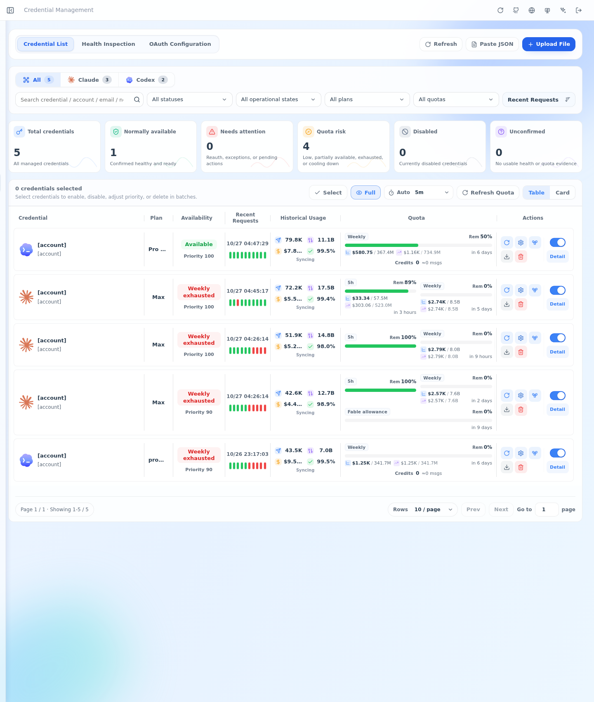
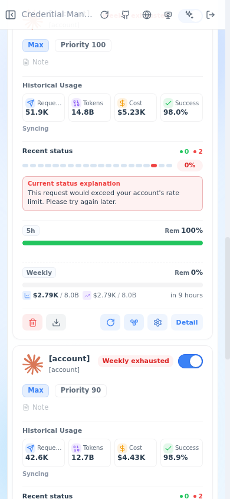

# Authenticated quota display verification

Verified on 2026-10-27 against the deployed account page.

- Inventory matched the two authenticated Codex and three authenticated Claude accounts.
- Eight general quota windows rendered, including idle Claude five-hour balances without reset timestamps. No reset boundaries were invented.
- Provider failures displayed their readable messages instead of JSON envelopes.
- Desktop and 390px mobile layouts had no page overflow, JavaScript errors, or failed HTTP requests. Manual quota refresh completed.
- All 4,538 web tests and 266 repository tests passed. Typecheck, lint (seven existing warnings), production build, demo isolation, and icon artifact checks passed.
- Three new regression cases failed against the previous implementation and passed with the fixes.
- Provider quota calls succeeded for all five accounts. Both history collectors remained healthy, with no dead letters or missing historical request/token totals in the checked windows.
- After deployment, Claude Sonnet and Opus plus GPT Sol and Astra returned `PROXY_OK` through the existing inference proxies. Streaming requests completed without error events. No inference services restarted.

Account identities are masked in these screenshots.

